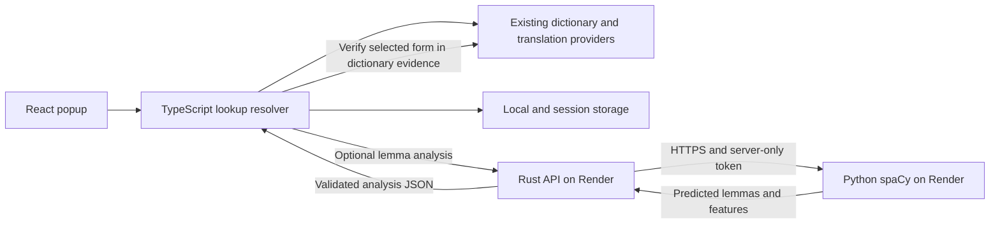

# Currywurst 2.0.0 roadmap

Planning document, researched 2026-11-12. This does not change the 1.6.2 runtime, deploy services, or introduce server traffic.

## Direction and scope

Build a React and TypeScript extension, a Rust API gateway, and a Python spaCy service on Render. The user selected **a free-tier prototype first**.

For this budget, the recommended 2.0.0 boundary is:

- React owns the popup UI and request lifecycle.
- Typed extension modules continue dictionary lookup, source verification, translation, pronunciation, and local vocabulary storage.
- Rust provides a versioned analysis API, input validation, bounded caching, rate limits, and communication with Python.
- spaCy proposes German lemmas and linguistic features. Dictionary sources establish meanings and detailed forms.

Start hosted analysis as an opt-in enhancement during the beta. Continue ordinary dictionary lookup when analysis is disabled, unavailable, or too slow. Server-side dictionary aggregation can follow after separate source-policy, caching, and parity work; it is not required for the first backend to be useful.

Retain both lookup directions, automatic selection lookup, article/degree/type alternatives, tab caching, source links, original-word and lemma pronunciation, missing-meaning and basic-translation fallbacks, local saved words with the current 100-word limit, delete/Undo, English localization support, and the Currywurst palette and Ko-fi link. Accounts, vocabulary sync, subscriptions, whole-page reading/highlighting, and spaced repetition are later product decisions.

The existing [TypeScript and React migration plan](TYPESCRIPT_REACT_MIGRATION.md) supplies the frontend implementation sequence. Preserve its build staging, source verification, storage compatibility, and test-transition work. This roadmap adds the backend and NLP decisions.

## What Lesewelle contributes

The [reference README](https://github.com/ValeryStatinov/lesewelle-frontend#readme) describes React/TypeScript/Vite, a Go gateway, Python spaCy, and grouping of separable and reflexive verbs. Adapt that separation to Rust. Its streamed translation and reading-widget features are separate product scope.

| Inspected source | Useful pattern | Currywurst decision |
| --- | --- | --- |
| [package.json](https://github.com/ValeryStatinov/lesewelle-frontend/blob/master/package.json) | Separate extension builds, TypeScript checking, React, and tests | Keep separate popup and worker builds; choose and lock compatible dependencies during implementation |
| [Content build](https://github.com/ValeryStatinov/lesewelle-frontend/blob/master/vite.config.content.ts) and [background build](https://github.com/ValeryStatinov/lesewelle-frontend/blob/master/vite.config.background.ts) | Independent entry points sharing a distribution directory | Clean staging once, then build both entries without erasing the other's output |
| [Content initialization](https://github.com/ValeryStatinov/lesewelle-frontend/blob/master/src/content/content.tsx) | React widget mounted in a Shadow Root | Keep Currywurst's popup as the 2.0 React entry; evaluate an in-page widget as a later feature |
| [Typed messages](https://github.com/ValeryStatinov/lesewelle-frontend/blob/master/src/core/chromeMessages/messages.ts) and [handlers](https://github.com/ValeryStatinov/lesewelle-frontend/blob/master/src/background/initialize/registerMessageListeners.ts) | Named requests, response types, dedicated handlers | Add runtime validation as well as TypeScript types; preserve direct local reads and worker-serialized mutations |

One integration detail deserves a regression test if an injected widget is added later: the inspected [activation code](https://github.com/ValeryStatinov/lesewelle-frontend/blob/master/src/background/initialize/initialize.ts) sends an activation message before awaiting content-script injection. That can encounter an absent receiver on first activation. Currywurst should inject, await readiness, then send a handled message.

The reference includes analytics and authentication-related modules. Currywurst's 2.0 scope keeps its current anonymous, local-vocabulary experience. Any reused code must retain the reference's [MIT notice](https://github.com/ValeryStatinov/lesewelle-frontend/blob/master/LICENSE). Pin the reviewed reference commit before borrowing implementation details; the links above follow `master`.

## Architecture



This keeps cold starts outside the critical path for common words. It also avoids porting the HTML parser to Rust at the same time as changing the UI and introducing NLP.

| Layer | Proposed stack | Ownership |
| --- | --- | --- |
| Extension | React, strict TypeScript, Vite, existing CSS, Chrome API types | UI, lookup coordination, provider adapters, audio, local data |
| Rust gateway | Axum, Tokio, Serde, reqwest, Tower middleware | Analysis contract, deadlines, cache, limits, Python client |
| NLP | Python, FastAPI, spaCy `de_core_news_sm` initially | Tokenization, POS, morphology, lemma prediction |
| Contracts | Versioned OpenAPI schema with generated TS client types | Shared wire format; runtime validation on both services and client |
| Deployment | Two Docker-based Render web services | Reproducible builds with pinned dependencies and model |

[Axum](https://docs.rs/axum/latest/axum/) integrates with Tokio and Tower. Vite supports React and TypeScript, but its build does not type-check: run a separate `tsc --noEmit` or project build check in CI. [Vite documentation](https://vite.dev/guide/features#typescript).

## Extension migration

Follow the detailed frontend draft in reviewable changes: staging/build, module boundaries, typed data, React shell, React lookup lifecycle, saved-word UI, then browser verification.

- Keep `manifest.json` as the version authority and validate any package version against it.
- Build the popup HTML with relative asset URLs and a separate bundled background worker. Keep the worker free of DOM parsing and React imports.
- Use React reducers and focused hooks initially. Retain existing CSS variables, SVG icons, sizing, table metadata, and localized Chrome messages.
- Treat dictionary HTML as input to the existing inert parser. React receives extracted text and validated data; it does not mount remote HTML.
- Bootstrap storage and one-use pending requests before mounting React. Development effect reruns must not replay lookup requests.
- Tie network work to an explicit lookup job ID and abort signal. Cancel on a new lookup, direction change, relevant navigation, or popup close. Abort plus a job-ID check protects against late responses.
- Saved words remain local with their existing IDs, source attribution, timestamps, and article/type distinctions. Preserve storage keys and record shapes so upgrading and rolling back do not require a data rewrite.
- Read the saved list without requiring a worker message receiver. Keep add/remove/Undo serialized in the worker.

All executable React and extension code must ship in the extension bundle. The server supplies data. [Manifest V3 remotely hosted code guidance](https://developer.chrome.com/docs/extensions/develop/migrate/remote-hosted-code).

## How NLP changes lookup

spaCy exposes lemmas, POS, and morphology through its processing pipeline and token annotations. Those predictions depend on the trained model and available context. [Pipeline documentation](https://spacy.io/usage/processing-pipelines), [token documentation](https://spacy.io/api/token).

Proposed German lookup flow:

1. Restore current-word/session caches where applicable.
2. Attempt exact dictionary resolution using the existing routes and source checks.
3. If unresolved and enhanced analysis is enabled, request one bounded NLP analysis.
4. Try up to two distinct predicted lemma candidates against permitted dictionary routes. Count these within the existing shared dictionary-request budget, rather than appending an unbounded new search.
5. Use remaining tested spelling/form recovery candidates when needed.
6. For a verified entry missing English, retain Wiktionary fallback and grammar-first rendering. For no verified entry or a dictionary failure, retain basic MyMemory translation and its separate deadline.

The first implementation must reserve dictionary requests for candidate verification and share the URL cache across NLP and heuristic candidates. Exact matches should not wait for NLP. Explicit EN-to-DE searches continue through the English lookup path; a German model is not a single-word language detector.

A predicted lemma is a suggestion until the selected surface form is supported by the dictionary's lemma, principal parts, stated forms, or inflection tables. Keep multiple source-attested genders and word types even when the model predicts only one. Missing NLP output and a service error must not become negative dictionary evidence.

spaCy does not supply English dictionary meanings, recorded audio, a complete paradigm generator, or calibrated per-token lemma confidence by default. Keep these concerns in their existing source-backed adapters. Do not add invented confidence scores or convert predicted morphology into authoritative declension tables.

**Context enhancement:** word-only analysis comes first. Sentence context is a separately gated enhancement, enabled explicitly after its privacy and memory checks. For example, resolving a selected `steht` in `Er steht früh auf.` to `aufstehen` requires access to the particle. A word-only request cannot establish that relationship. Dependency-based grouping needs additional logic and evaluation for the pinned German pipeline; installing spaCy alone does not implement Lesewelle's grouping behavior.

For context requests, send only a bounded sentence and the exact selected span. Specify offset units in the contract, handle JS UTF-16 versus Python Unicode indices, and keep original context intact while mapping offsets. Normalize the lookup token separately. Test combining umlauts, emoji before the selection, repeated words, punctuation, and selections across text nodes. Keep context out of persisted caches and request logs.

## API contract

Use `/v1` for API compatibility independently of extension version 2.0.0. A minimal prototype needs only:

| Endpoint | Consumer | Purpose |
| --- | --- | --- |
| `POST /v1/analyses` | Extension | Request German word analysis without putting the word in a URL query |
| `GET /healthz` | Render/operator | Confirm the Rust process is running; do not wake Python from this probe |
| `GET /readyz` | Render/operator | Confirm gateway initialization is complete |
| `POST /internal/v1/analyses` | Rust only | Invoke Python with a server-only token |
| Python `/healthz` and `/readyz` | Render/operator | Separate process liveness from model readiness |

Illustrative request:

```json
{
  "text": "auseinandergesetzt",
  "language": "de"
}
```

Illustrative response shape, not a measured spaCy result:

```json
{
  "schemaVersion": 1,
  "requestId": "opaque-request-id",
  "model": { "name": "de_core_news_sm", "version": "pinned-model-version" },
  "candidates": [
    {
      "lemma": "auseinandersetzen",
      "pos": "VERB",
      "morph": { "VerbForm": ["Part"] },
      "evidence": "model_prediction"
    }
  ]
}
```

An empty candidate list is a valid analysis outcome. It is different from service failure. The service should return only predictions it actually obtains; the client can merge these with its separately identified heuristic candidates.

Set initial limits at one selected word, 160 characters and 500 UTF-8 bytes, a small JSON body limit, and no batch endpoint. If context is implemented, version or extend the schema explicitly with a small sentence limit and span validation. Limit response lengths, candidate counts, and token counts before rendering or caching.

Use consistent error JSON containing `requestId`, `code`, `retryable`, and an appropriate HTTP status: `400` malformed JSON, `413` oversized body, `422` invalid fields/language, `429` rate limit with `Retry-After`, `502` invalid NLP response, `503` unavailable model/service, and `504` upstream deadline. Validate JSON as `unknown` at the client boundary. Do not accept caller-supplied provider URLs or expose a general fetch/proxy endpoint.

Prototype warm-service targets, to be measured: a two-second Rust-to-NLP deadline, roughly three seconds total client analysis allowance, and one analysis attempt per lookup. On failure continue the current resolver. Brief service backoff is separate from a word's negative cache, so a cold start does not mark that word as missing. The extension can abort its request; server deadlines and concurrency limits independently bound work already accepted upstream.

## Free Render deployment

Use two **Free public web services** for the prototype. Their 750 monthly instance hours are shared within the workspace. Idle services sleep after 15 minutes and a wake-up can take around a minute; two services may incur sequential cold starts. Local filesystem changes are ephemeral, and free Postgres expires after 30 days. These constraints make a dependency-free normal lookup path important. [Render free-instance documentation](https://render.com/docs/free).

Free services cannot receive private-network traffic, and private services have no free instance type. The prototype Rust-to-Python connection therefore uses the public HTTPS URL with a server-only token. Later, a paid Python private service can replace that public endpoint. [Private networking](https://render.com/docs/private-network), [compute plans](https://render.com/docs/compute-plans).

| Service | Deployment | Prototype configuration |
| --- | --- | --- |
| Rust API | Free Docker web service | Bind `0.0.0.0:$PORT`; small bounded in-memory analysis cache; outbound HTTPS to NLP |
| Python NLP | Free Docker web service | Bind `0.0.0.0:$PORT`; one worker; bounded inference concurrency; load one pinned German model at startup |
| Vocabulary | Existing browser storage | Remains available independently of either server |

Render supports Docker builds from repository Dockerfiles and requires public web services to bind the expected host/port. [Docker deployment](https://render.com/docs/docker), [port binding](https://render.com/docs/web-services#port-binding).

Start with `de_core_news_sm`, which spaCy lists as a German news-text pipeline. Bake the compatible model into the image at build time and load it once through the application lifespan. Exclude unused components only after checking their dependencies; word-only analysis may avoid NER and dependency parsing, while sentence grouping may need the parser. [German pipelines](https://spacy.io/models/de), [pipeline dependencies](https://spacy.io/usage/processing-pipelines), [FastAPI lifespan](https://fastapi.tiangolo.com/advanced/events/).

**Feasibility gate:** measure model startup, warm latency, peak RSS, and a small concurrent workload on the actual free instance. The current free compute plan is 512 MB; fitting Python, spaCy, and the selected pipeline must be demonstrated. Use a provisional memory-headroom target around 400 MiB, then set it from measurement. If the model does not fit reliably, revisit the pipeline or hosting budget before making hosted analysis a release dependency. [Render compute specifications](https://render.com/docs/compute-plans).

Do not add a database or Redis solely for this prototype. Bounded process caches may disappear safely; client data remains local. Do not use automatic keep-alive pings to simulate an always-on service. Include a deliberate cold-start test with a long operator-only deadline; ordinary popup requests should fall back promptly. Avoid routing long cold-start waits through extension worker messages: Chrome documents worker termination conditions including slow fetch responses. [Worker lifecycle](https://developer.chrome.com/docs/extensions/develop/concepts/service-workers/lifecycle).

## Privacy, permissions, and operational limits

Explain hosted analysis before it is enabled: the selected word goes to the developer-operated Rust service and then Python on Render. Context, if offered, has a separate explicit setting. Update privacy disclosures and store answers before enabling the feature publicly. Do not send page URLs, the saved list, or the full document.

Request only the API origin as an optional host permission during an explicit enable action. The extension does not need direct permission for the Python host. Keep existing provider permissions for the direct resolver. [Chrome optional permissions](https://developer.chrome.com/docs/extensions/reference/api/permissions).

Keep `NLP_BASE_URL` and the Rust-to-Python token in server environment variables. A `VITE_*` variable is public bundle configuration, suitable for the API URL, not a secret. Anonymous extension calls need bounded rate/concurrency limits; CORS and extension IDs are not authentication. Process-local limits are prototype controls and reset on restart, so public-scale abuse protection needs a separate readiness review.

Cache only bounded word-analysis results with keys including normalization, model version, and analysis options. Keep transient failures out of word-negative caches. Log request IDs, durations, status codes, and model versions rather than words or sentences. Account for platform access-log behavior in the final disclosure.

## Repository layout

Retain the root extension structure proposed by the frontend draft, adding service directories:

```text
manifest.json                   # canonical extension version and permissions
src/                            # popup, background, shared, dictionary modules
services/
  api/
    Cargo.toml
    Cargo.lock
    src/                        # routes, validation, cache, NLP client, errors
    Dockerfile
  nlp/
    pyproject.toml
    uv.lock
    src/                        # app, model lifecycle, schemas, analysis
    tests/
    Dockerfile
contracts/
  nlp-v1.openapi.yaml
tests/
  unit/
  popup/
  extension/
render.yaml                     # two prototype services; secrets are references
dist/
  extension/                    # built extension only
  Currywurst-<version>.zip
```

Pin dependency versions and model artifacts after compatibility testing. Generate client types from the contract and validate service implementations against it. Backend and model versions can deploy independently while preserving `/v1` compatibility with installed extensions.

## Implementation milestones

| Milestone | Deliverable | Exit criterion |
| --- | --- | --- |
| 0. Baseline and hosting spike | Record 1.6.2 behavior; evaluate spaCy locally and on Render Free | Current regression coverage retained; actual model memory and cold/warm behavior measured |
| 1. Build and TypeScript foundation | Follow frontend draft's staging, modules, contracts, and typed providers | Loadable artifact; strict checks for migrated code; unchanged storage and lookup behavior |
| 2. React popup | Replace rendering incrementally; keep existing look and workflows | UI, audio, alternatives, cancellation, fallbacks, and saved-word parity |
| 3. Rust analysis gateway | Versioned API, validation, cache, errors, mocked NLP client | Contract tests, timeout/error handling, limits, and token protection pass |
| 4. spaCy service | Pinned model, one-worker deployment, real analysis corpus | Model results evaluated; readiness and memory gates pass |
| 5. Optional integration | Add NLP suggestions to the bounded resolver | Every accepted candidate is source-verified; unavailable API preserves direct lookup |
| 6. Context experiment | Optional sentence selection and particle/reflexive grouping | Offset, privacy, accuracy, and memory checks pass; otherwise defer this feature |
| 7. Beta and release | Built-extension tests, upgrade rehearsal, live smoke checks, documentation | Both browsers and final ZIP verified; 1.6.2 data survives upgrade and rollback |

Keep each milestone reviewable and the extension loadable throughout. Do not combine UI migration, parser rewrites, and server-side provider migration in one change. The frontend draft estimates 10–14 engineering days; a provisional total including the gateway, NLP, and integration is roughly 4–6 weeks for one maintainer, with overlap possible. Re-estimate after the Render/model spike. This is a planning estimate, not measured delivery time.

## Verification and release gates

Carry forward the current 182 executable behavior tests as a baseline, preserving their assertions even when test structure changes. Run the existing browser-only HTML parser fixtures in a DOM-capable automated suite. Add React DOM tests, generated-contract checks, Rust formatting/Clippy/tests, Python validation/tests, and actual-model linguistic evaluations.

Use a new held-out word set for the NLP gate, including ambiguous participles, irregular subjunctives, nominalized adjectives, noun genders, compounds, mixed case, combining umlauts, and separable/reflexive sentence pairs. Report lemma candidate coverage and wrong-entry acceptance separately. Require zero wrong entries in the source-verification regression set and no lookup regression when NLP is offline; set improvement thresholds only after collecting the baseline. Keep a held-out set separate from examples used to tune heuristics.

Exercise Rust asleep, Python asleep, sequential cold starts, malformed JSON, model OOM/restart, `429`, `503`, deadlines, cancellation, stale results, and lost caches. Verify that basic translation, recorded audio/browser speech, and offline vocabulary browsing remain usable under the appropriate source availability.

Run a packaged-extension smoke suite with Playwright's supported Chromium setup and verify installation in Chrome and Edge. Include a small live check of the deployed API and a few provider lookups before release; fixture tests alone do not meet this gate. [Playwright extension testing](https://playwright.dev/docs/chrome-extensions).

Update the existing GitHub release workflow to build and package only `dist/<version>/extension/`, validate referenced chunks/locales/icons, and preserve ZIP checksums and release notes under `dist/<version>/`. Exclude server code, `.env` files, and local configuration. Backend deploys and extension releases should have distinct jobs and readiness criteria.

For prereleases, keep the manifest's numeric version valid and put a human-readable beta label in `version_name`. Extend the release tooling deliberately if beta tags are introduced; the current packaging script expects an exact numeric manifest/tag match. Use a separate beta installation profile/ID while testing. [Chrome version rules](https://developer.chrome.com/docs/extensions/reference/manifest/version).

The first concrete work item is a baseline-and-feasibility PR: preserve the 1.6.2 artifact and storage fixtures, define the analysis contract, and benchmark the smallest suitable spaCy pipeline on Render Free. Then establish the extension build using the existing frontend migration plan.
